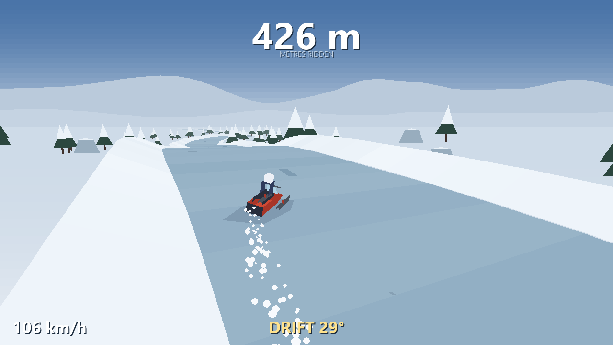
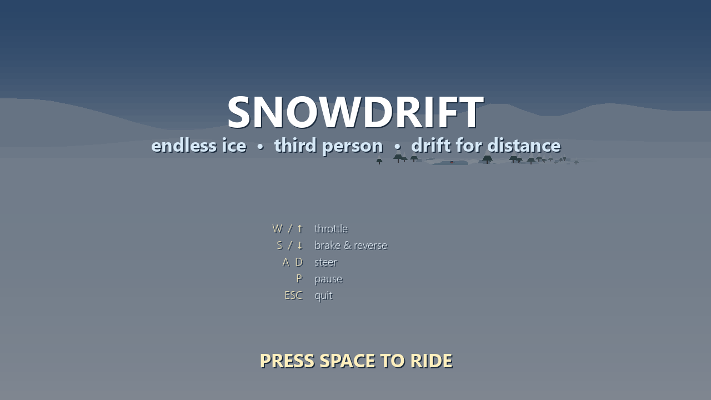

# SNOWDRIFT

An endless, randomly generated ice track you ride in third person on a
snowmobile. Points are metres: the further you drift, the higher the number on
top of the screen. Written in Python with **pygame only** - the 3D is a small
software renderer, so there is no OpenGL, no GPU requirement and no asset pack.




## Run it

```bash
python -m pip install -r requirements.txt
python main.py
```

Options: `--seed N` (repeat a track), `--stats` (fps / polygon / RAM overlay),
`--fullscreen`, `--size 1600x900`. Requires Python 3.10+ and `pygame-ce`.

## Controls

| Key | Action |
| --- | --- |
| `W` / `Up` | throttle |
| `S` / `Down` | brake, then reverse |
| `A` `D` / `Left` `Right` | steer |
| `P` | pause |
| `R` | restart on a new track |
| `Esc` | pause / quit |

Snow banks line both sides of the ice. Clipping one bounces you back and costs
speed, so the fast line is a smooth one.

## The plan

The brief was: pygame, 3D third person, randomly generated, **infinite** track,
drift handling, and care about RAM. Those constraints drive every decision.

**1. 3D without OpenGL.** A GPU pipeline would add PyOpenGL/moderngl as a
dependency and a fragile context on Windows, for a scene that is only a few
hundred polygons. Instead there is a painter's-algorithm rasteriser: vertices
are transformed into camera space, clipped against the near plane
(Sutherland-Hodgman), projected, fogged toward the horizon colour, sorted
back-to-front and filled with `pygame.draw.polygon`. The scene is low-poly and
flat-shaded on purpose - that is the art style, not a compromise.

**2. The track is a function, not a map.** A track is a ribbon swept along a
path. Each station (a cross-section, 4 m apart) advances by a curvature and a
height taken from two smooth value-noise fields, both keyed only on the station
index. Nothing is stored in order to know what comes next, so the track has no
end and no size. `TrackStream` keeps a dict of stations around the player:
generate ahead (`GEN_AHEAD`), delete what falls behind (`prune`).

**3. Memory stays flat.** The window of live stations is constant (~190 of them
whether you have ridden 100 m or 100 km), the spray is a preallocated 200-slot
ring buffer, and no per-frame list is kept. Measured: **~42 MB RSS, +0.7 MB
across 3,600 frames** of continuous riding. Geometry beyond `FOG_END` is culled
before projection, so the cost of distance does not grow either.

**4. Drift physics.** The sled carries forward and lateral velocity in its own
frame. Steering rotates the heading but never the velocity vector, so the nose
leads into the slide; a low lateral grip (worse at full throttle, that's the
power slide) is what lets the tail step out. Two stabilisers keep it drivable
rather than a spin-out toy: past ~41° of slip the edge bites hard, and with the
bars centred the sled straightens itself out. Measured: 26° of slip after 0.4 s
at 106 km/h on 0.8 steering.

**5. Distance is the score.** `score` is the furthest point along the track
reached, in metres, so nothing decays and riding backwards cannot farm points.
It is the big number at the top of the screen.

## Measured

On this machine (Python 3.14, pygame-ce 2.5.6, 1280x720, headless video driver):

| | |
| --- | --- |
| Frame cost | 0.21 ms physics + 7.4 ms draw & present |
| Frame time | median 7.1 ms, p95 9.8 ms -> 60 fps with headroom |
| Ceiling | ~135 fps |
| Polygons on screen | 400 - 460 |
| Live track stations | 187, constant |
| RSS | ~41 MB, +0.6 MB over 3,600 frames |
| Distance in 60 s (autopilot) | ~1.86 km |

`python main.py --stats` shows fps, polygon count, RSS and the seed live. Frame
times above come from a real 1280x720 window with the display present included,
over 300 frames.

## Layout

```
main.py                 CLI, window and main loop
snowdrift/config.py     every tunable constant
snowdrift/util.py       hash noise, colour mixing, RSS measurement
snowdrift/track.py      infinite station stream, track queries
snowdrift/sled.py       drift physics
snowdrift/renderer.py   camera, near clipping, projection, fog, sky, mountains
snowdrift/particles.py  fixed-size snow spray
snowdrift/hud.py        score, speed, drift, title and pause screens
snowdrift/game.py       input, stepping, scene assembly, sled mesh
```

## Tuning

Handling lives in `snowdrift/config.py`: `GRIP_BASE` and
`GRIP_THROTTLE_LOSS` control how loose the ice feels, `STEER_RATE` how quickly
the nose comes round, `ENGINE`/`MAX_SPEED` the pace. Track shape comes from
`TrackStream._curvature` and `_height`; `GEN_AHEAD`, `KEEP_BEHIND` and
`RENDER_FAR` are the memory/visibility knobs.

## Screenshots

`screenshots/drift.png` is a genuine frame from the game at 106 km/h with 29°
of slip, captured by driving the real render path; `screenshots/title.png` is
the title screen.

## Known limits

- Software rasteriser: no real-time shadows, reflections or transparency, and
  the painter's algorithm can order overlapping geometry imperfectly.
- Snow spray is drawn as circles sorted in front of the sled rather than depth
  sorted with the world.
- There is no lap, finish line or fail state - it is a distance run by design.
