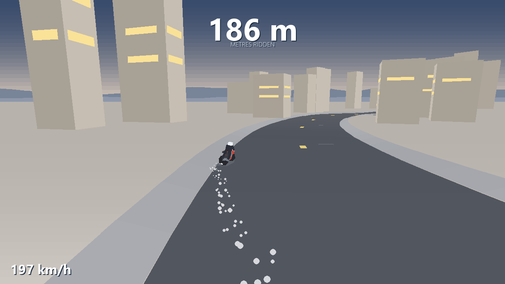
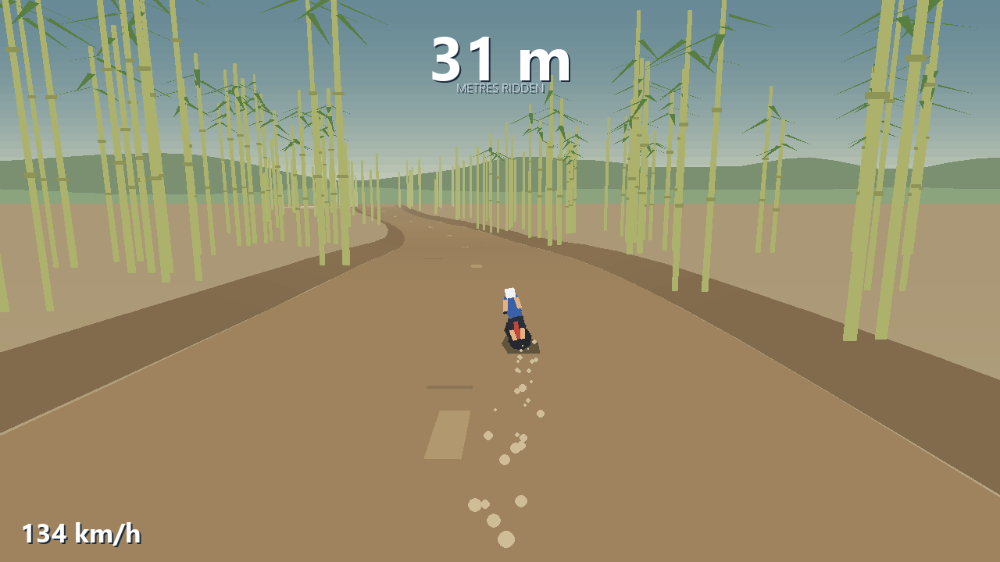

# SNOWDRIFT

An endless, randomly generated drifting game seen in third person. Points are
metres: the further you drift, the higher the number at the top of the screen.
Written in Python with **pygame only** - the 3D is a small software renderer,
so there is no OpenGL, no GPU requirement and no asset pack.

Three runs share the same road, physics and scoring, and swap the world around
them:

| Run | You ride | Road | Roadside |
| --- | --- | --- | --- |
| **Ice Run** (default) | snowmobile | ice | tall, close-packed pines |
| **City Run** | motorbike | asphalt | skyscrapers with lit windows |
| **Dirt Run** | bicycle | packed dirt | bamboo |






## Run it

```bash
python -m pip install -r requirements.txt
python main.py
```

Options: `--seed N` (repeat a track), `--theme snow|city|dirt`, `--stats`
(fps / polygon / RAM overlay), `--fullscreen`, `--size 1600x900`. Requires
Python 3.10+ and `pygame-ce`.

## Controls

| Key | Action |
| --- | --- |
| `W` / `Up` | throttle |
| `S` / `Down` | brake, then reverse |
| `A` `D` / `Left` `Right` | steer |
| `1` `2` `3` or `Left` `Right` | choose the run, on the title screen or while paused |
| `P` | pause |
| `R` | restart on a new track |
| `Esc` | pause / quit |

Changing the run while paused rebuilds the world in the new palette and puts
you back exactly where you were, so distance and speed carry over.

Banks line both sides of the road. Clipping one bounces you back and costs
speed, so the fast line is a smooth one. Top speed is about 300 km/h, and the
tightest corners are cut for roughly that, so the throttle is usable.

## The plan

The brief was: pygame, 3D third person, randomly generated, **infinite** track,
drift handling, several looks over the same game, and care about RAM. Those
constraints drive every decision.

**1. 3D without OpenGL.** A GPU pipeline would add PyOpenGL/moderngl as a
dependency and a fragile context on Windows, for a scene that is only a few
hundred polygons. Instead there is a painter's-algorithm rasteriser: vertices
are transformed into camera space, clipped against the near plane
(Sutherland-Hodgman), projected, fogged toward the theme's fog colour, sorted
back-to-front and filled with `pygame.draw.polygon`. Drawing runs in two
passes - road first, then props and rider - because a strip you have already
driven over spans from under the camera to the rider and would otherwise be
sorted back over the top of it.

**2. The track is a function, not a map.** A track is a ribbon swept along a
path. Each station (a cross-section, 4 m apart) advances by a curvature and a
height taken from two smooth value-noise fields, both keyed only on the station
index. Nothing is stored in order to know what comes next, so the track has no
end and no size. `TrackStream` keeps a dict of stations around the player: 160
ahead and 160 behind (`GEN_AHEAD`, `GEN_BEHIND`), with anything outside that
window deleted (`prune`). Each station is derived from its neighbour, so the
sweep can be built forwards or unwound backwards - which is why spinning round
and riding back never runs off the end of the ice.

**3. Looks are data.** A theme (`snowdrift/themes.py`) is just a palette plus
which props line the road and which mesh you ride: surface, banks, fog, sky,
hills, prop colours, prop density, prop draw distance. Stations bake their
colours in when they are generated, so switching theme rebuilds the stream.
Adding a fourth look means adding one `Theme(...)` literal.

**4. Memory stays flat.** The window of live stations is constant (~320 of them
whether you have ridden 100 m or 100 km), the spray is a preallocated 200-slot
ring buffer, and no per-frame list is kept. Measured: **~41 MB RSS, +0.6 MB
across 3,600 frames** of continuous riding. Geometry beyond `FOG_END` is culled
before projection, so the cost of distance does not grow either.

**5. Props are level of detail, not scenery soup.** Pines, bamboo and buildings
are generated from the station index like everything else, then drawn in full
detail only inside `detail_far` and as a single silhouette polygon beyond it.
Bamboo clumps are two jointed culms with a spray of leaves at the crown;
buildings are boxes that emit only the walls the camera is actually outside
of, so the tower stays solid as you ride past it. That is what lets the forest
be dense enough to close off the view without costing a frame budget.

**6. Drift physics.** The sled carries forward and lateral velocity in its own
frame. Steering rotates the heading but never the velocity vector, so the nose
leads into the slide; a low lateral grip (worse at full throttle, that's the
power slide) is what lets the tail step out. Two stabilisers keep it drivable
rather than a spin-out toy: past ~41° of slip the edge bites hard, and with the
bars centred the sled straightens itself out. Measured: 26° of slip after 0.4 s
at 106 km/h on 0.8 steering.

**7. Distance is the score.** `score` is the furthest point along the track
reached, in metres, so nothing decays and riding backwards cannot farm points.
It is the big number at the top of the screen.

## Measured

On this machine (Python 3.14, pygame-ce 2.5.6, 1280x720, headless video driver,
autopilot at full throttle):

| | Ice Run | City Run | Dirt Run |
| --- | --- | --- | --- |
| Frame time | median 5.0 ms, p95 6.5 | median 5.5 ms, p95 7.2 | median 8.5 ms, p95 10.8 |
| Polygons on screen | ~440 | ~417 | ~729 |

| | |
| --- | --- |
| Ceiling | ~100 - 130 fps, 60 fps with headroom |
| Live track stations | 321, constant |
| Top speed, straight line | 304 km/h |
| RSS | ~41 MB, +0.6 MB over 3,600 frames |
| Distance in 60 s (autopilot) | ~3.5 km |

`python main.py --stats` shows fps, polygon count, RSS, seed and theme live.

## Layout

```
main.py                 CLI, window and main loop
snowdrift/config.py     feel and budget: window, fog, streaming, physics
snowdrift/themes.py     palette + props + player mesh for each run
snowdrift/util.py       hash noise, colour mixing, RSS measurement
snowdrift/track.py      infinite station stream, scenery, track queries
snowdrift/sled.py       drift physics
snowdrift/renderer.py   camera, near clipping, projection, fog, sky, hills
snowdrift/particles.py  fixed-size dust/spray
snowdrift/hud.py        score, speed, drift, title and pause screens
snowdrift/game.py       input, stepping, scene assembly, meshes
```

## Tuning

Handling lives in `snowdrift/config.py`: `GRIP_BASE` and
`GRIP_THROTTLE_LOSS` control how loose the ground feels, `STEER_RATE` how
quickly the nose comes round, `ENGINE`/`MAX_SPEED`/`AIR_DRAG` the pace, and
`GEN_AHEAD`/`GEN_BEHIND`/`RENDER_FAR` the memory and visibility budget. Track
shape comes from `TrackStream._curvature` and `_height`. Colour, scenery and
the rider live in `snowdrift/themes.py`.

## Screenshots

Every image in this README is a genuine frame captured by driving the real
render path, not a mock-up.

## Known limits

- Software rasteriser: no real-time shadows, reflections or transparency, and
  the painter's algorithm can order overlapping geometry imperfectly.
- Dust and snow spray are drawn as circles in front of the scene rather than
  depth sorted with it.
- Buildings are boxes with banded windows; there is no city layout behind them
  and no traffic.
- The bicycle and motorbike are fixed meshes with non-spinning wheels.
- There is no lap, finish line or fail state - it is a distance run by design.
